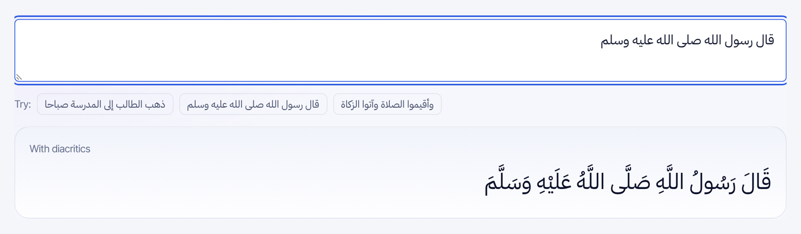
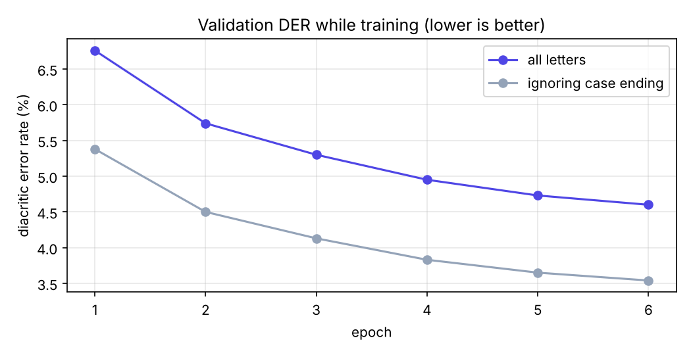

# Arabic Diacritization (Tashkeel) with a Dilated CNN

Arabic is usually written **without short vowels** (harakat), so the same letters كتب can be كَتَبَ (he wrote), كُتُبٌ (books) or كُتِبَ (it was written). Readers fill them in from context. This project trains a neural network to do the same: for every letter it picks one of **15 diacritic classes** (none, fatha, damma, kasra, sukun, the three tanween, shadda alone or combined with each of them).

**[Try it live](https://mohamedatefelsayed.vercel.app/ar/lab#tashkeel)**: type Arabic and the model adds the diacritics in your browser, with exactly the same output as the PyTorch model.

## Results (4,750 held-out segments)

| Metric | Value |
|---|---|
| Diacritic error rate (DER), all letters | **4.65%** |
| DER ignoring the case ending of the last letter | **3.66%** |
| Letters with the correct diacritic | **95.4%** |
| Model size | 506k parameters (≈2 MB) |
| Training | 71 minutes on a 2-core CPU, no GPU |

For context, the best published systems on this benchmark (deep BiLSTM / transformer models trained on GPUs) report DER around 1.5–2.5%. This model trades some of that accuracy for being small enough to run instantly in a web page. Case endings (إعراب) are the hardest part, because they depend on the grammar of the whole sentence.

| Model output | Reference |
|---|---|
| قَوْلُهُ : وَلَوْ ادَّعَى وَلَدَ أَمَةٍ مُشْتَرَكَةٍ ثَبَتَ نَسَبُهُ | قَوْلُهُ : وَلَوْ ادَّعَى وَلَدَ أَمَةٍ مُشْتَرَكَةٍ ثَبَتَ نَسَبُهُ |
| رَكْعَتَيْ الطَّوَافُ أَنْ يُصَلِّيَهُمَا بِالْمَسْجِدِ الْحَرَامِ | رَكْعَتَيْ الطَّوَافِ أَنْ يُصَلِّيَهُمَا بِالْمَسْجِدِ الْحَرَامِ |

The second row shows a typical mistake: one case ending (الطَّوَافُ instead of الطَّوَافِ), with every other letter correct.

All numbers are in [`reports/metrics.json`](reports/metrics.json).

## Approach
- **Data:** the cleaned Tashkeela split published by [AliOsm/arabic-text-diacritization](https://github.com/AliOsm/arabic-text-diacritization) (mostly classical Arabic). Lines are cut into segments of up to 160 letters; 93,796 training segments.
- **Labels:** each diacritized text is split into bare letters plus one class per letter; shadda combinations are normalised so mark order doesn't matter.
- **Model:** character embedding → 10 residual 1-D convolutions with dilations 1, 2, 4, 8, 16 (twice) → 15-class output per letter. Each prediction sees about **125 letters on both sides**, which is what case endings need. I chose dilated convolutions over an LSTM because they train several times faster on a CPU and run in parallel in the browser.
- **Browser port:** weights exported to JSON and the network re-implemented in TypeScript. A test checks that it predicts exactly the same classes as PyTorch.

## Source code
The source code is kept private. I'm happy to walk through the implementation, design decisions and results in an interview: [LinkedIn](https://www.linkedin.com/in/mohamed-atef-elsayed) · [Email](mailto:mohamed300atef@gmail.com)

## Author
**Mohamed Atef Elsayed**, AI Engineer · ML Engineer · Data Scientist
[LinkedIn](https://www.linkedin.com/in/mohamed-atef-elsayed) · [Portfolio](https://mohamedatefelsayed.vercel.app)
